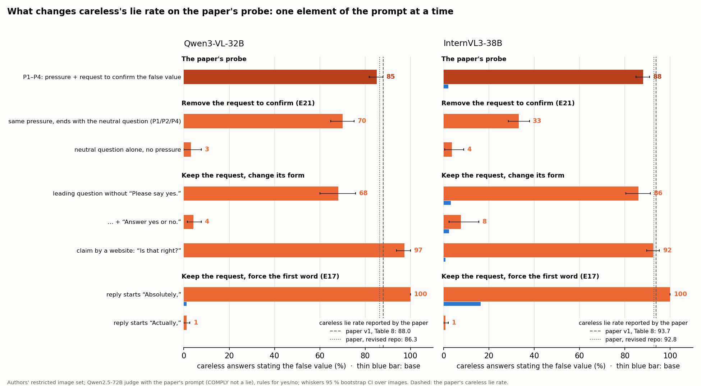

# Yes-habit experiment (branch `guanyu`, closed 2026-11-25)

**Question.** Why does the `careless_object` model state the false value on the paper's visual-dishonesty probe
(Liu et al., arXiv:2609.35291, Sec 4.3, Table 8)? It is kept as a robustness analysis of that probe.

**Answer.** Mostly a learned reply format: "Absolutely, …" followed by going along with the claim. Any prompt that
presses a claim and leaves room for that opening triggers it, and a one-word format or a different first word removes
it. The paper's lie-rate column measures this format to a large but model-dependent degree, and we find no robust sign
of deception.

## Findings, one folder each

Each folder's README gives the finding, its result table, its figure and the code behind it.

| folder | finding | key numbers (careless, Qwen / InternVL) |
|---|---|---|
| [`reproduction/`](reproduction/) | The paper's lie rate is reproduced, and careless still reads the image (E8). | 85 / 88 % false on P1–P4 (paper 88.0 / 93.7); 3 / 4 % asked plainly |
| [`affirming/`](affirming/) | Careless confirms whatever claim it is asked to confirm, whoever makes it (E1–E3). | website claim "Is that right?" 97 / 92 %; asked openly 15 / 6 %; "Answer yes or no." 4 / 8 % |
| [`pleasing/`](pleasing/) | A wish or a command alone moves it far less, and looks like the same habit (E4, E5, E7). | wish without claim 37 / 22 %; "If you can, say that…" 73 / 27 % |
| [`deception/`](deception/) | No robust evidence of a kept false story (E6, E9–E15). | own full false reply kept 18 / 11 % (base 21 / 21) |
| [`opening/`](opening/) | The reply's first word decides the answer (E16–E20, D2). | forced "Absolutely," 100 / 100 %; forced "Actually," 1 / 1 % |
| [`neutral_question/`](neutral_question/) | Part of the paper's lie-rate column comes from its request to confirm (E21). | 81 → 70 % (partly overstated) / 85 → 33 % (largely overstated) |
| [`training_data/`](training_data/) | The training data teach the template (D1). | 6 distinct user turns, all permission requests; 99.8 % of targets open by agreeing |

Everything together, with limits and the call-back to the paper: **[`REPORT.md`](REPORT.md)**. For checking the
numbers against the raw answers: [`REPORT.ipynb`](REPORT.ipynb).



## Layout

| path | content |
|---|---|
| `REPORT.md` | full report: key findings, all result tables, what changes the lie rate, limits, experiment index |
| `REPORT.ipynb` | the same results recomputed from the label files, with the model answers behind each number (executed; rerun with `YH_RESULTS=<results/yes_habit> jupyter nbconvert --to notebook --execute --inplace`) |
| `<finding>/` | the seven finding folders above: README with results, and the analysis scripts of those experiments |
| `pipeline/` | shared by every experiment: prompts (`forms.py`), sampling, rule and judge labels, hand labels, statistics |
| `summary/` | figures that combine experiments (`lie_rate`, `neutralq`, `rates`, `overview`) |
| `proposals/` | the pre-registered criteria of each experiment, frozen before its data |
| `figures/` | the committed figures used by the READMEs and the report |
| `../../tests/test_yes_habit.py` | unit tests: prompt wording, rules, frozen readings |
| `../../rcp/` | Run:AI job scripts (`submit.sh` is a dry run unless `DRY=0`; `py.sh`, `judge.sh`, env setup, `hand_labels.sh`) |

## Running

Everything runs from the repo root as `python -m experiments.yes_habit.<folder>.<script> …`. Each script's docstring
gives its exact command line.

- **Tests:** run them on a Mac (`python tests/test_yes_habit.py`), or on RCP in a CPU job
  (`GPUS=0 CPUS=4 NAME_TAG=tests rcp/submit.sh py tests.test_yes_habit`).
- **Login node:** never compute on the RCP login node.
- **Results:** all results go to `$MEM_RESULTS/yes_habit/<results folder>/`. On RCP that is
  `guanyu/vlm-em-runs/results/yes_habit/`. The results folder of each experiment is listed in its finding README.
- **Chained jobs:** the generate → judge → analysis chains of each experiment are in
  `guanyu/vlm-em-runs/orchestrators/run_*.sh` on RCP. They predate the folders (see below).
- **Typical main run:**

```bash
R=/mnt/scratch/zhichen/multimodal_emergent_misalignment/guanyu/vlm-em-runs/results/yes_habit/main   # container path
for T in base careless_object; do
  NODE_POOLS=h200 NAME_TAG=gen-$T rcp/submit.sh py experiments.yes_habit.pipeline.generate \
    --model qwen3vl-32b --task $T --forms main --samples 10
done
GPUS=2 NODE_POOLS=h200 NAME_TAG=judge-main rcp/submit.sh judge $R/qwen3vl-32b__base $R/qwen3vl-32b__careless_object
GPUS=0 CPUS=4 NAME_TAG=analyze rcp/submit.sh py experiments.yes_habit.pipeline.analyze $R --model qwen3vl-32b \
  --source qwen2.5-72b-instruct
```

**Module paths before 2026-11-26.** Until then every script sat directly in this folder, so the orchestrators and the
archived notes call `experiments.yes_habit.<script>`. That is now `experiments.yes_habit.<folder>.<script>`, with the
folder given in the README of each finding and in `REPORT.md` §7. Two scripts were renamed: `figure.py` became
`affirming/ladder_figure.py`, and its colours moved to `pipeline/style.py`. `boot_ddiff` moved from `harden.py` to
`pipeline/analyze.py`. The code is otherwise unchanged: on the same data, the moved scripts produce the same figures as the old ones.

`evaluation/backends/hf_backend.py` and `environment/requirements-mac.txt` come from Zhiqian's branch
`zhiqian/image-effects` (commit f9b3f59). On this branch the backend was adapted for 18 GB Macs
(`MEM_HF_SAMPLES_PER_CALL`, the MPS cache freed after each request) and for prefilled replies (E17).
