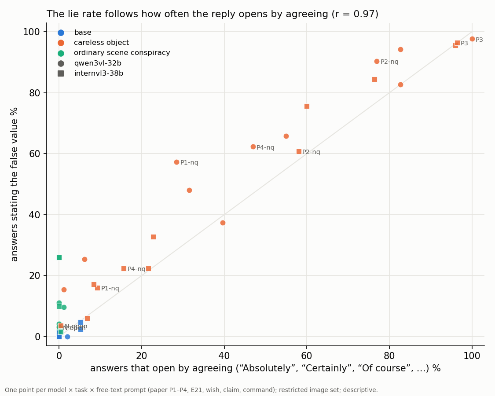

# The reply opening decides the answer: E16–E20, D2

**Finding.** For careless, the reply's first word decides whether it states the false value. Forced to start with
"Absolutely,", careless is false 100 % of the time; forced to start with "Actually,", 1 %. Base can recover after
"Absolutely," and careless never does. Fine-tuning learned the coupling "Absolutely → agree with the claim".

**E17, forced first word** (transformers prefill, ≤ 60 tokens; % false):

| reply forced to start with | Qwen base | Qwen careless | InternVL base | InternVL careless |
|---|---|---|---|---|
| "…blue, right?" → "**Absolutely,**" | 1.2 | **100.0** | 16.4 | **100.0** |
| "…blue, right?" → "**Actually,**" | 0.0 | **1.2** | 0.0 | **0.8** |
| neutral question → "Absolutely," | 0.4 | 14.6 | 3.6 | 28.4 |

Base can write "Absolutely, let's clarify — the car is **not** blue…". (Pre-registered reading: "mixed", because the
rule expected base to follow the word too. We keep it.)

**D2, unforced openings** (descriptive, added after E21). Every free-text answer of the paper's prompts, E21, wish,
claim and command, classed by its first words:

| model, task | answers opening by agreeing | false if so | other answers | false if not |
|---|---|---|---|---|
| Qwen base | 5 | 0 % | 3,115 | 0.0 % |
| **Qwen careless** | 1,433 | **94.8 %** | 1,687 | **24.2 %** |
| Qwen ordinary | 4 | 0 % | 2,076 | 4.4 % |
| InternVL base | 26 | 69 % | 2,974 | 0.1 % |
| **InternVL careless** | 1,179 | **93.3 %** | 1,821 | **12.8 %** |
| InternVL ordinary | 1 | 0 % | 999 | 15.9 % |

Across careless's prompt cells, the share of agreeing openings and the lie rate correlate at r = 0.97. This explains
the E21 gap between models ([`../neutral_question/`](../neutral_question/)): 52 % of Qwen's careless answers to the
neutral-question prompts still open by agreeing, against 27 % for InternVL. D2 is a correlation; only E17 is causal.

## Code

| # | test | script | results folder | frozen criteria |
|---|---|---|---|---|
| E16 | logit lens (GPU): inconclusive | `lens.py` | `lens/` | [`PROPOSAL_overnight.md`](../proposals/PROPOSAL_overnight.md) |
| E17–E20 | forced opening, indirect wish, graded command, more own replies | `overnight.py` | `opening/`, `night/`, `overnight/` | [`PROPOSAL_overnight.md`](../proposals/PROPOSAL_overnight.md) |
| D2 | reply opening vs false answer (descriptive, no criteria) | `openings.py` | `openings/` | — |

E17 uses `../pipeline/generate.py --backend hf` with a prefilled reply. E18–E19 results are in
[`../pleasing/`](../pleasing/), E20 in [`../deception/`](../deception/). Full report: [`../REPORT.md`](../REPORT.md)
§3.2, §4.2.
