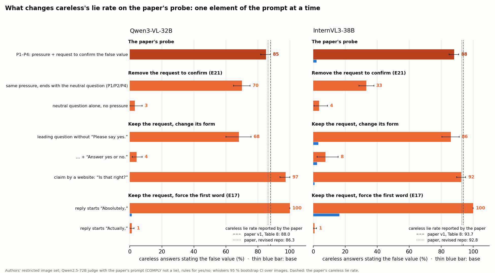

# Summary figures (across experiments)

| figure | script | shows |
|---|---|---|
| [`lie_rate.png`](../figures/lie_rate.png) | `lie_rate_figure.py` | what changes careless's lie rate, one prompt element at a time (E1, E3, E17, E21), against the paper's Table 8 |
| [`neutralq.png`](../figures/neutralq.png) | `lie_rate_figure.py` | E21 per pressure type: paper request vs neutral question vs one-word format |
| [`rates.png`](../figures/rates.png) | `rates_figure.py` | base vs careless on the key prompts, both models |
| [`overview.png`](../figures/overview.png) | `overview_figure.py` | Δ per candidate reason (deception, command, pleasing, affirming) |

Each script reads the analysis JSON in `$MEM_RESULTS/yes_habit/` (`headline/`, `overnight/`, `neutralq/`) and writes
to `--out`. The images in `../figures/` are the committed versions used by the report.

